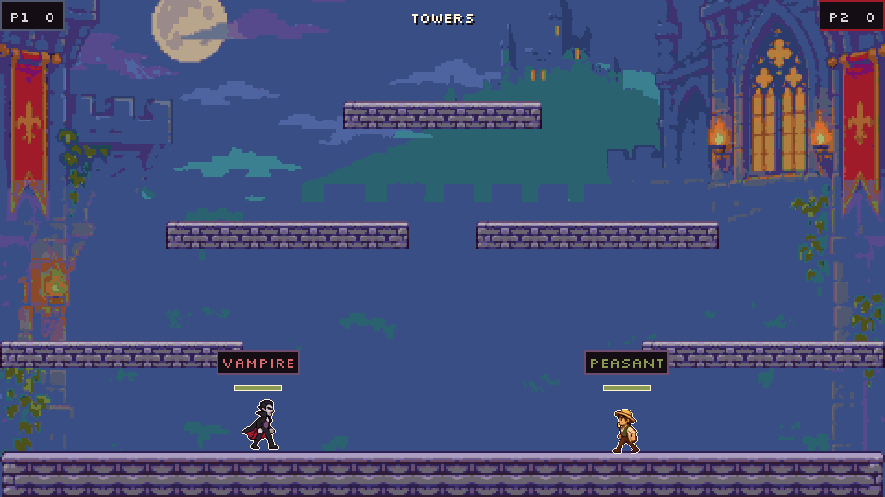
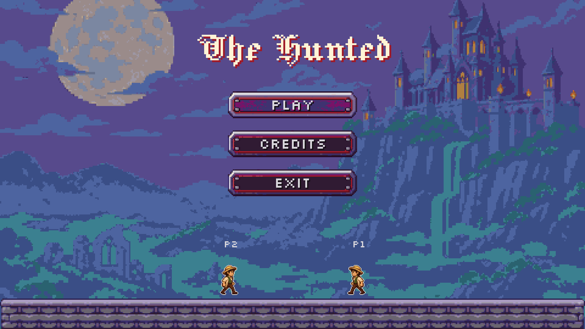
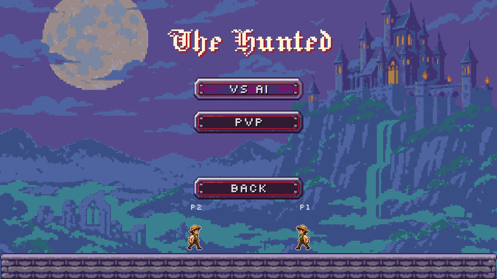
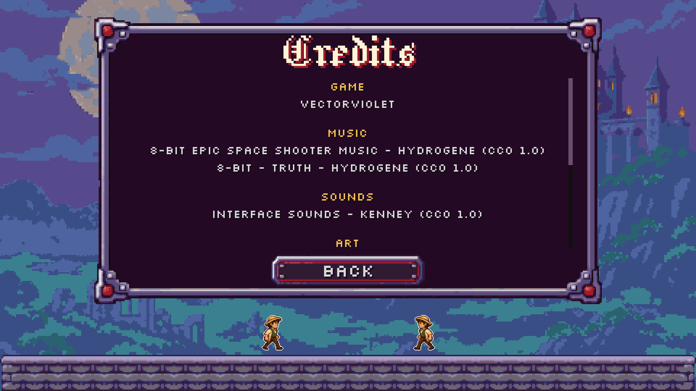
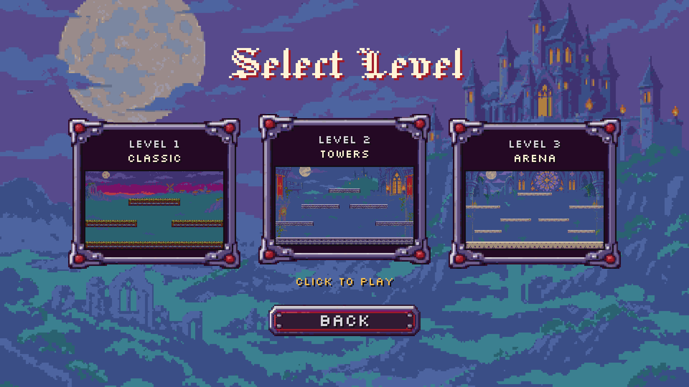
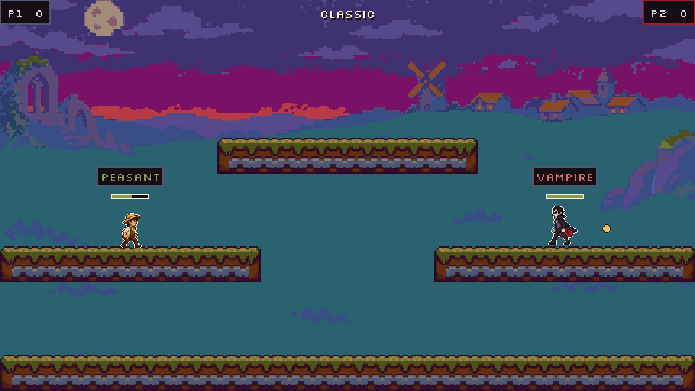
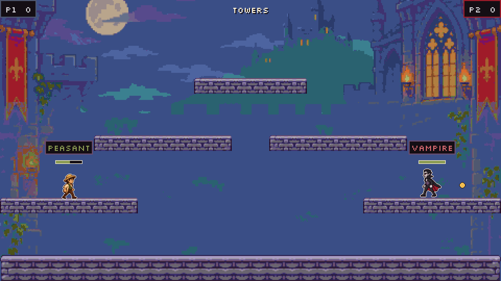
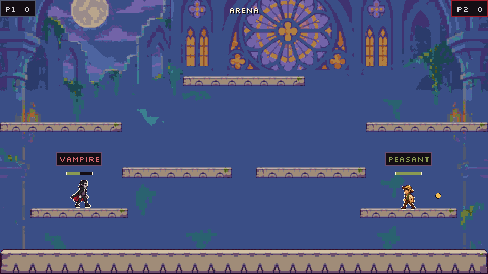

# The Hunted


My first-ever pygame project — kept here as a learning artifact. A goofy couch platformer for one player against the AI (VS AI) or two on one keyboard (PVP): one player is the vampire, the other the peasant, roles randomized each round. It's a chase-and-catch party game, not a horror game.

> **Note on assets:** the code and game logic are mine. All the art (characters, backgrounds, platforms, buttons, cursor, countdown) is my own AI-generated pixel art (OpenAI Codex image generation, in one style: see [the style guide](docs/design/art-style.md)); the fonts are open (SIL OFL) and the music and sounds come from properly licensed packs. Everything is credited in [CREDITS.md](CREDITS.md).

**[Play it in your browser on itch.io](https://umutcanekinci.itch.io/the-hunted)**, or [download it](#download) (Windows installer and zips, macOS, Linux).



## Gameplay

- In every round, one player becomes the **vampire** and the other a **peasant**, chosen randomly.
- The vampire is **faster** and wins by catching/touching the peasant.
- Only the peasant can **fire bullets**.
- **VS AI** pits you against a built-in **AI opponent** with separate vampire / peasant behaviors; **PVP** is two players on one keyboard.
- Three levels to chase across: **Classic**, **Towers** and **Arena**.

### Menu

**PLAY** opens the mode menu (**VS AI**, **PVP**, **BACK**); picking a mode starts the countdown and then the level select. **CREDITS** shows everyone whose work is in the game, and **EXIT** quits (in the browser it shows a "Thanks for playing" popup). **BACK** and Esc go up one page.

### Screenshots

| Main menu | Mode menu | Credits |
|-----------|-----------|---------|
|  |  |  |

| Level select | Classic | Towers | Arena |
|--------------|---------|--------|-------|
|  |  |  |  |

### Controls

| Action | Player 1 | Player 2 |
|---|---|---|
| Move | Arrow keys | WASD |
| Jump | Up arrow | W |
| Fire | Right Ctrl | Space |

In VS AI mode you control **both keysets** and play against the AI.

## Download

[](https://umutcanekinci.itch.io/the-hunted)

Grab a ready-to-play build for your OS from [itch.io](https://umutcanekinci.itch.io/the-hunted) or the [latest GitHub release](https://github.com/vectorviolet/hunted/releases/latest) — no Python required. On Windows, run the installer, or unzip and run:

| OS | Run |
|----|-----|
| Windows | Run `hunted-windows-setup.exe` (choose the setup language and the install folder, e.g. `C:\Games`; it adds a Start Menu shortcut and, if you tick it, a desktop one), or extract `hunted-windows.zip` and run `hunted.exe` |
| macOS | Extract `hunted-macos.zip`, open `Hunted.app` |
| Linux | Extract `hunted-linux.zip`, run `./hunted/hunted` |

> macOS Gatekeeper: the app is unsigned, so the first launch needs **right-click → Open** (or `xattr -dr com.apple.quarantine Hunted.app`).
>
> Windows SmartScreen: the app is unsigned, so the first launch shows **"Windows protected your PC."** Click **More info → Run anyway**. This is Microsoft's download-reputation check, not a virus warning — brand-new unsigned executables always trigger it. The installer is unsigned too and shows the same warning.

**In the browser.** Play it on [itch.io](https://umutcanekinci.itch.io/the-hunted) without installing anything (desktop browser with a keyboard; the game is 960x540, so use the fullscreen button; click the page to start; F11 toggles fullscreen). The same build is attached to each GitHub release as `hunted-web.zip`; to build and test it yourself see [CONTRIBUTING.md](CONTRIBUTING.md#browser-build).

## Requirements (from source)

- Python 3.12+
- [pygame-ce](https://github.com/pygame-community/pygame-ce) (resolved automatically from `pyproject.toml` / `uv.lock`)
- [uv](https://docs.astral.sh/uv/) (optional but recommended)

## Running

```bash
git clone --recurse-submodules https://github.com/vectorviolet/hunted.git
cd hunted
uv sync
uv run python __main__.py
```

If you forgot `--recurse-submodules`: `git submodule update --init`.

Without `uv`: `pip install .` then `python __main__.py`.

## Building a standalone bundle

Builds are produced by [PyInstaller](https://pyinstaller.org/) from `hunted.spec`, which bundles `assets/` alongside the executable (onedir). To build locally for your current OS:

```bash
uv sync --group build
uv run pyinstaller hunted.spec --noconfirm
```

The result lands in `dist/hunted/` (`dist/Hunted.app` on macOS).

### Cutting a release

Per-OS bundles for Windows, macOS, and Linux, a Windows installer and the browser build are built and published automatically by [`.github/workflows/release.yml`](.github/workflows/release.yml) when a version tag is pushed:

```bash
git tag v0.1.0
git push origin v0.1.0
```

The workflow builds on each OS, zips the bundle, attaches the zips (and then the installer and the web zip) to a GitHub Release (with auto-generated notes), and pushes each build, the browser build included, to its [itch.io](https://umutcanekinci.itch.io/the-hunted) channel via [Butler](https://itch.io/docs/butler/). Use the workflow's **Run workflow** button to test a build without publishing.

## Project layout

```
__main__.py            Entry point — injects src/ + src/pygamine/ into sys.path
src/game.py            Game class — state machine over menu / level-select / game
src/world.py           GameWorld dataclass (platforms, bullets, window dims)
src/entities.py        Player, Platform, Projectile
src/combat.py          Bullet physics + round transitions
src/input_handler.py   KeyboardInputHandler + AIInputHandler protocols
src/menu.py            The menu pages (main, mode, credits, web popup): layout, buttons, scrolling
src/credits.py         The credits text: credits_data.py, generated from assets/SOURCES.yaml
src/renderer.py        Level-select + in-game drawing
src/audio.py           Menu / game music
src/cursor.py          Custom multi-state cursor
src/settings.py        Physics, combat, the palette colors, and 3 level layouts (960x540 canvas)
src/util/              Frozen-build resource path resolution, the browser check
web/                   Browser build: pygbag entry point, loader page, icon
packaging/             Windows installer script (Inno Setup) and its icon
src/pygamine/       Engine submodule (used only for Application + Mouse + GameObject)
assets/                Images, sounds and fonts
docs/                  Architecture, devlog, art style guide, screenshots, itch.io store text (docs/store/)
scripts/               Smoke test, credits and devlog generators, art and media scripts
```

See [docs/ARCHITECTURE.md](docs/ARCHITECTURE.md) for the architecture overview.

## Author

Umutcan Ekinci — [umutcannekinci@gmail.com](mailto:umutcannekinci@gmail.com)

See also the [contributors](https://github.com/vectorviolet/hunted/contributors).

## License

The **code** in this repository is licensed under the MIT License — see the [LICENSE](LICENSE) file.

The **vampire and peasant sprites** are AI-generated (OpenAI Codex image generation) for this game and are not CC0; the rest of the assets come from third-party packs under their own licenses (CC0, CC BY or OFL), credited in [CREDITS.md](CREDITS.md). [`assets/SOURCES.yaml`](assets/SOURCES.yaml) lists every asset file with its source.

## Credits

Every pack, font, track and library the game uses, with its author and license, is in [CREDITS.md](CREDITS.md), which also ships with every build. The asset packs' license texts are in [`licenses/assets/`](licenses/assets/); the software's texts (pygame-ce and its libraries) come from [`src/pygamine/pygamine/licenses/`](src/pygamine/pygamine/licenses/) and are bundled into each build's `licenses/` folder. The vampire and peasant sprites are AI-generated for this game (see CREDITS.md).

## Contributing and security

See [CONTRIBUTING.md](CONTRIBUTING.md) for setup, checks and the asset rules, [docs/ARCHITECTURE.md](docs/ARCHITECTURE.md) for how the code fits together and [SECURITY.md](SECURITY.md) to report a vulnerability.
