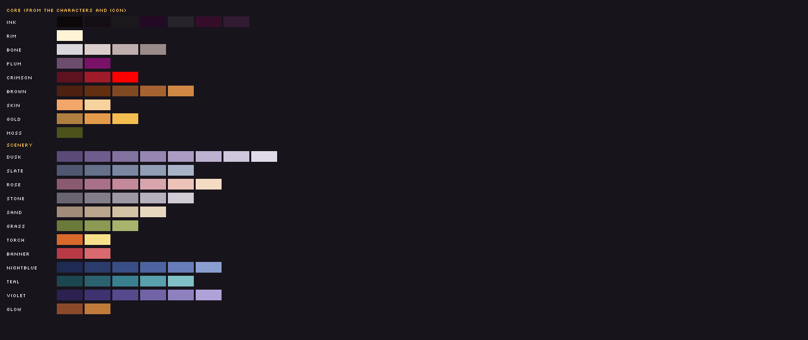

# Hunted art style guide

Status: picked by the owner (2026-11-20) and applied in the game (issue #19). The anchors are the new characters (`assets/images/vampire/`, `assets/images/peasant/`, PR #16)
and icon A (PR #17). The one rule above all others: **everything looks like it was drawn by the
same hand as the characters.**

## Palette

One shared palette of 82 colors; every generated asset is reduced to exactly these colors with
hard edges (`scripts/art_gen/palette.py` is the single source of truth, `process.py` snaps to it).

**Core, read off the sprites and the icon:**

| Group | Hex |
|---|---|
| ink (outlines, shadows) | `#0c080a #140e14 #1c191c #240924 #28242b #350d2a #301b33` |
| rim (the characters' outline) | `#fff4d6` |
| bone | `#d9d7dc #dbcdcb #beaead #9a8b8a` |
| plum | `#6c4d6e #791267` |
| crimson | `#5e111f #9f1b29 #ff0000` |
| brown | `#4d2110 #642e11 #7f4a22 #a76232 #cf8944` |
| skin | `#f4a668 #f6d29c` |
| gold | `#b07f40 #e49b49 #f3be51` |
| moss | `#4c521a` |

**Scenery ramps in the same hue families (dark to light). The night ramps (nightblue, teal, violet, glow) are for the backgrounds; the lighter ones serve platforms, UI and accents:**

| Ramp | Hex |
|---|---|
| dusk (lilac) | `#5b4a78 #6e5d8c #8272a0 #9686b2 #aa9cc2 #bdb2d0 #cfc7dc #e0dae8` |
| slate | `#4f5870 #65708a #7b87a1 #929db6 #aab4c9` |
| rose | `#8a5a70 #a8708a #c48a9c #d9a5ac #ecc3b8 #f4dcc4` |
| stone | `#6a6470 #837d8a #9d97a4 #b7b1bd #d0cbd4` |
| sand | `#a08c78 #b9a58c #d2c1a4 #e6d8bf` |
| grass | `#6a7a3a #8a9a52 #a8b46c` |
| torch | `#d9692a #f6e08a` |
| banner | `#b83a45 #d86a70` |
| nightblue | `#1e2a52 #2b3b6b #3a4e86 #4d64a0 #667db8 #8a9ed0` |
| teal | `#1c4650 #2a6270 #3b8090 #58a0ae #82c0c8` |
| violet | `#2c2150 #3f3270 #574a8c #7263a8 #8f80c0 #aea2d8` |
| glow | `#8a4a2a #c07a3a` |

Dark violet-black (`#140e14`) is for outlines and shadows only, never for large areas of
scenery. Saturated colors (crimson, torch, gold) are accents.

## Pixel scale

- **Characters: 1x.** 64x64 frames, drawn 1 art pixel = 1 screen pixel (already done).
- **Scenery and UI: 2x.** They are made at 400x300 (half of the 800x600 game) and enlarged with
  nearest neighbor, so one art pixel is 2x2 screen pixels. Reasons: AI generation does not hold a
  true 1 px grid at 800x600, and chunkier scenery behind finer characters helps the characters
  read. This is a deliberate, single rule; there are no mixed scales inside one asset.
  (If the owner wants everything at 1x, the pipeline has one constant, `SCALE` in
  `scripts/art_gen/process.py`, but the detail gets noisy.)
- Text: pixel fonts only at whole multiples of their native grid (see Font).

## Outline rule

- Characters: 1 px light outline, `#fff4d6`, around the whole silhouette (PR #16, after the
  play-test: a dark character disappeared against a dark tree line).
- Scenery, platforms and UI: 1 px **dark** ink outline on the shapes that must be read as objects
  (platforms, buttons, panels, cursors, digits). Background scenery has no outline at all, only
  tone steps. So light outline means "a thing that moves", dark outline means "a thing you stand
  on or click".

## Light direction

Upper left, from the moon. Highlights sit on top and left edges (platform tops, button bevels,
panel borders), shadow and crimson trim on the bottom and right. Pressed buttons lose the shadow
and move down one pixel.

## Readability rule (owner, 2026-11-20, second version)

Characters must stand out from every background. The first version of this rule made every
background pale and lighter than the characters; the owner found all of it too bright (see the
devlog). Now that the characters carry a 1 px `#fff4d6` outline, the separation comes from the
**outline, hue and value together**, not from a pale background.

1. Backgrounds are **night or deep-dusk and moody**: mid-dark values with real saturation
   (grade: luma 40 to 170, saturation 110%), dominated by deep blue, teal and violet, with a pale
   moon and a few warm lights as accents.
2. **Standing band (40% to 90% of the height) and behind every platform:** luma held to about
   68 to 125 (rule: 55 to 120). No near-black (nothing under 40), nothing near the vampire's body
   tones (luma 30 to 60) directly behind a character, and no saturated red near the cape (red is
   the vampire's color).
3. **Cool against warm:** deep blue, teal and violet suit the vampire's black and red and the
   peasant's warm browns and straw hat.
4. Detail sits in the upper part and at the far left and right edges; the middle stays calm.
5. Platforms and ground are dimmed to a moonlit tone and keep their dark ink outline, so the
   standing surface always reads.

Measured by `scripts/art_gen/mockups.py` (it renders both characters with their outline at the
mockup positions and checks the background behind them): all 8 candidates pass. Standing-band luma
mean is 79 to 90 (minimum 59 to 78, maximum 109 to 141), 0% of the band is under 40, red is under
1%, and the vampire-tone backdrop behind the characters is 0%. The vampire's body (luma about 46)
is darker than the background, the peasant's (about 80) is the same value, so he separates by
warm hue and outline, which is why cool backgrounds matter.

## Backgrounds

800x600, one per level plus the menu. The owner's picks, from two moods each (the rejected
candidates are in the devlog, `docs/devlog/2026-11-20-art-style-candidates.md`):

| Screen | File | Scene |
|---|---|---|
| Menu | `background/menu.png` | gothic castle on a cliff under a big moon |
| Classic | `background/classic.png` | violet dusk with a magenta horizon glow, windmill and village |
| Towers | `background/towers.png` | blue castle courtyard, torches, a glowing window |
| Arena | `background/arena.png` | cathedral ruin with a glowing rose window |

They are single images, not parallax layers: the map never scrolls, so layers would add nothing,
and composed scenes read better. Which picture a level uses is `background` in `settings.LEVELS`.
The scene continues to the bottom edge; the ground strip is overlaid at `settings.GROUND_Y`.

## Platforms and ground

Per level, one material that matches its background: Classic mossy earth, Towers castle brick,
Arena sandstone (kept on purpose; its dark outline separates it from the Arena backdrop). Each is a
**3-slice sheet** (left cap 16 px, tiled middle 32 px that is a patch plus its mirror so it repeats
seamlessly, right cap 16 px) at the height that level's platforms use in `settings.LEVELS`:
Classic 50, Towers 30, Arena 20 px (`platform/<style>.png`), plus a 50 px ground strip
(`ground/<style>.png`). `entities.Platform` builds any width with `pixelart.three_slice`; `style`
in `settings.LEVELS` names the art.

## UI

- **Buttons:** forged iron, normal, hover, pressed, 224x64 px, no text (the label is drawn in code
  in Silkscreen). `buttons.make_button` stretches them with `pixelart.nine_slice` (14 px corners).
- **Panel/popup frame** and **level-select card frame:** iron with crimson gems, 9-slice with a
  20 px border, flat interior (`ui/panel.png`, `ui/card.png`).
- **Cursor:** arrow, pointing hand, grabbing hand, about 28 px.
- **Countdown:** the glyphs 3, 2, 1, GO!, bone-white with a crimson lower edge and fang drips; each
  shows for 15 frames and drops in over the first five.
- **HUD** (drawn in code, palette colors only): ink plates with a 2 px edge (slate for P1, crimson
  for P2, plum for the role tags), a bar with a 1 px `#fff4d6` outline, labels in Silkscreen.
- **Bullets:** gold with a 1 px ink outline (they used to be black, which vanishes at night).

## Font

Titles ("The Hunted", "Select Level", "Credits"): **Jacquard 12** (a gothic pixel blackletter).
Everything else (buttons, HUD, labels, hints): **Silkscreen**. Both are SIL OFL 1.1 static TTFs from
Google Fonts (`google/fonts`, `ofl/`), with license texts in `licenses/assets/` and entries in
`assets/SOURCES.yaml`. Jacquard 12 is only legible in mixed case and at 24 px or larger, so it is
for titles only (used at 72); Silkscreen is capitals on an 8 px grid, used at 16, 24 and 48. Both
are drawn without anti-aliasing. Comic Neue and the candidate Press Start 2P are gone.

## How the assets are made

`scripts/art_gen/`: `prompts.py` (every prompt), `generate.py` (Codex image generation with the
sheets and icon as style references), `process.py` (crop, night grade, palette snap, hard alpha,
3-slice, 2x; writes the owner's picks to `assets/images/`), `shoot.py` (screenshots of the game),
`make_media.py` (README screenshots, preview.gif, store covers, devlog comparisons). Generation is
not deterministic and the raw pictures (about 1.3 MB each) are not committed: they go to the
gitignored `scripts/art_gen/work/`. Only the final assets, the prompts and the scripts are in the
repo. The scripts need Pillow and numpy, in the optional `art` dependency group:
`uv run --group art python scripts/art_gen/process.py`.
