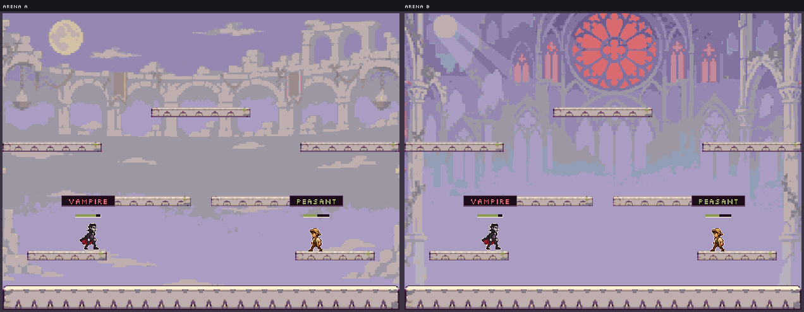
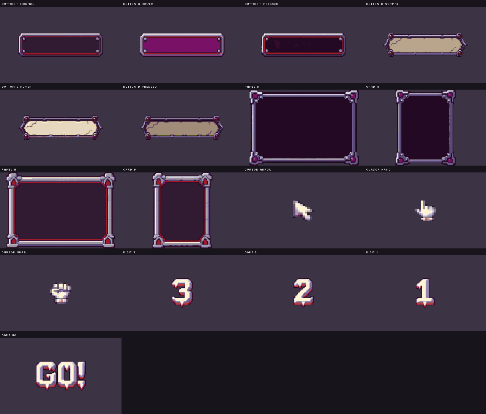
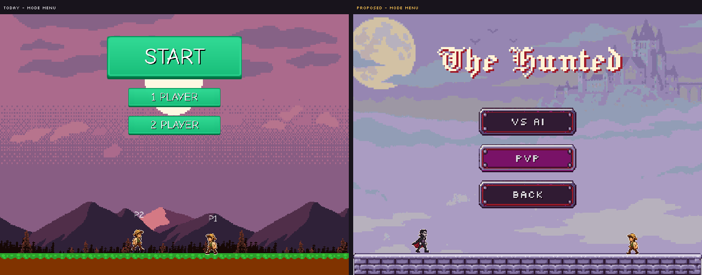
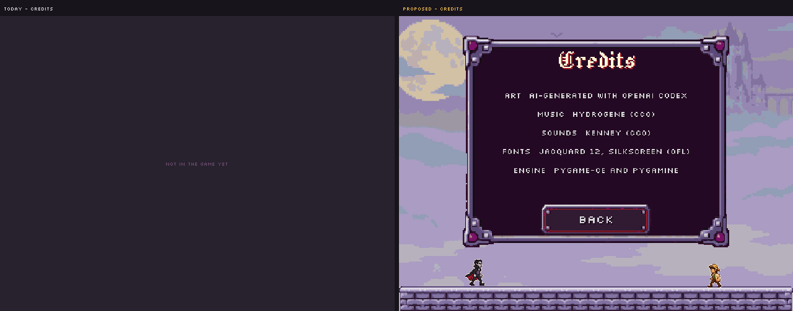
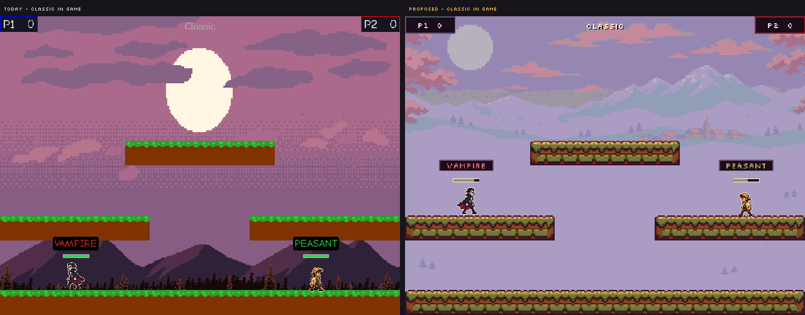
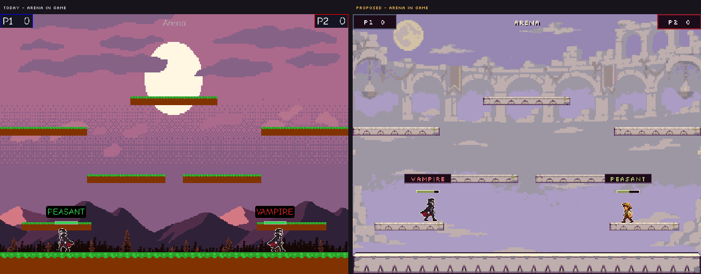

# One art style: guide and generated candidates
<!-- index | refs: #19 -->

**Date:** 2026-11-20 · **Area:** Art · **Issue:** [#19](https://github.com/vectorviolet/hunted/issues/19)

This is phase 1 of #19: a style guide and generated candidates for the owner to pick from. No game
code changed and none of the new assets is wired in. The style guide is
[`docs/design/art-style.md`](../design/art-style.md).

## Context

The new characters (#8) and icon A (#9) are pixel art in a dark gothic palette, but the rest of
the game is a CC0 mountain parallax, a green-grass tile, Kenney's green buttons and Comic Neue.
The owner's priority: one consistent style everywhere, and characters that stand out from every
background (light outline, backgrounds lighter and duller, no dark band at standing height).

## Approach

1. Read the palette off the sprites and the icon (the "core" ramps), then add lighter, duller
   "scenery" ramps in the same hue families: 63 colors in `scripts/art_gen/palette.py`.
2. Generate each piece with Codex image generation (`codex exec`), with the vampire sheet, the
   peasant sheet and icon A attached as style references. Every prompt is in
   `scripts/art_gen/prompts.py`; they share one style paragraph and, for backgrounds, one
   readability paragraph ("mid-to-light dull tones, no dark bands, calm middle").
3. `scripts/art_gen/process.py` cleans each picture up: crop to 4:3, grade into a lighter and duller
   luma band, snap to the palette with no dithering, remove stray pixels, key out the magenta and
   keep hard alpha, build the 3-slice platform sheets and 9-slice-ready frames, enlarge 2x.
4. `scripts/art_gen/mockups.py` composites the screens from the generated assets, the real
   character frames and the real fonts, next to screenshots of current main.

Style reference prompt (shared by every job):

> Crisp retro pixel art in exactly the style of the attached reference images (the vampire and
> peasant walk sheets and the vampire face icon): hard pixel edges, NO anti-aliasing, no blur, no
> gradients, no dithering noise, no painterly texture, a small limited palette (violet-black, deep
> purple, dusk lilac and gray, bone white, crimson, warm torch orange, straw gold, moss green,
> brown). Light comes from the upper left (the moon). No text, no letters, no people, no
> creatures, no watermark.

Background rule paragraph (appended to each scene description):

> ... READABILITY matters most: mid-to-light tones only, dull and desaturated, low contrast; NO
> dark bands, NO black silhouettes, NO dark tree line or dark wall in the lower two thirds; the
> area between 40% and 90% of the height must stay calm, light and uncluttered. Strong detail only
> in the upper part and at the far left and right edges. ...

## Candidates

Backgrounds, two moods per screen (A is the default):

Each level with its platforms, ground and both characters, A left and B right:

Buttons, panels, cards, cursor and countdown (two button styles and two frame styles, A is the
default):

Fonts (A is the default):

Every generated asset in one picture:

## Mockups, today versus proposed

Today is a screenshot of current main (`scripts/art_gen/shoot_today.py`); the mode menu, credits
and web popup are the pages of #18 and the browser build and do not exist yet, so they only show
the proposal (the mode menu shows today's main menu for reference).

## Decision

Open: the owner picks. Defaults (chosen by Claude as the starting point): background A for every
screen, button and frame style A, fonts A (Jacquard 12 for titles only plus Silkscreen), 2x pixel
scale for scenery and UI.

## Rejected attempts along the way

- **Ungraded backgrounds.** The first test picture (a castle courtyard at night) was beautiful but
  dark with black walls; the dark vampire would vanish in it. Hence the readability paragraph in
  the prompts and the grading step.
- **A harder grade** (luma 100 to 206, saturation 70%) made the backgrounds look washed out and
  flat; the final grade is 70 to 205 at 80%.
- **Jacquard 12 for everything.** The blackletter caps in "THE HUNTED" and on the buttons were
  unreadable, so it is for mixed-case titles only. Its digits are also hard to read, so the HUD
  uses Silkscreen.
- **Raw 1536x1024 pictures at 1x.** AI "pixel art" does not keep a true pixel grid, so downscaling
  to 800x600 gave mush; working at 400x300 and enlarging 2x keeps hard edges.
- **Separate parallax layers.** Not attempted: the map never scrolls, so layers add nothing, and
  composed scenes read better than re-randomized layers.

## Known issues

- The lower half of every background is a calm, almost flat lilac field. That is the readability
  rule doing its job, but it can look empty; a second pass could add soft mist layers.
- Arena platforms (sandstone) are close in tone to the Arena A background; the dark outline
  separates them.
- Arena platforms are only 10 art pixels tall, so the detail is minimal there.
- The 3-slice middle is a patch plus its mirror, so very long platforms show a mirrored pattern.

## Result

31 candidate images in `assets/images/style/`, three OFL fonts in `assets/fonts/`, all listed in
`assets/SOURCES.yaml` (AI-generated with OpenAI Codex, not CC0, approved by the owner on
2026-11-20). Phase 2 swaps the picked assets in and removes the rest.
