# One art style: guide and generated candidates
<!-- index | refs: #19 -->

**Date:** 2026-11-20 · **Area:** Art · **Issue:** [#19](https://github.com/vectorviolet/hunted/issues/19)

Phase 1 of #19 made a style guide and generated candidates for the owner to pick from (no game
code); phase 2, at the end of this entry, applies the owner's picks in the game. The style guide
is [`docs/design/art-style.md`](../design/art-style.md).

## Context

The new characters (#8) and icon A (#9) are pixel art in a dark gothic palette, but the rest of
the game is a CC0 mountain parallax, a green-grass tile, Kenney's green buttons and Comic Neue.
The owner's priority: one consistent style everywhere, and characters that stand out from every
background (light outline; separation by outline, hue and value; no near-black at standing height).

## Approach

1. Read the palette off the sprites and the icon (the "core" ramps), then add "scenery"
   ramps (night blue, teal, violet, plus lighter ones for platforms and UI) in the same hue
   families: 82 colors in `scripts/art_gen/palette.py`.
2. Generate each piece with Codex image generation (`codex exec`), with the vampire sheet, the
   peasant sheet and icon A attached as style references. Every prompt is in
   `scripts/art_gen/prompts.py`; they share one style paragraph and, for backgrounds, one
   readability paragraph (night mood, mid-dark cool values, no near-black or red in the middle).
3. `scripts/art_gen/process.py` cleans each picture up: crop to 4:3, grade into the night luma band
   (40 to 170, held to about 68 to 125 in the standing band), snap to the palette with no dithering, remove stray pixels, key out the magenta and
   keep hard alpha, build the 3-slice platform sheets and 9-slice-ready frames, enlarge 2x.
4. A mockup script (since removed, phase 2 uses real screenshots) composited the screens from
   the generated assets, the real character frames and the real fonts, next to screenshots of
   main as it was.

Style reference prompt (shared by every job):

> Crisp retro pixel art in exactly the style of the attached reference images (the vampire and
> peasant walk sheets and the vampire face icon): hard pixel edges, NO anti-aliasing, no blur, no
> gradients, no dithering noise, no painterly texture, a small limited palette (violet-black, deep
> purple, deep blue, teal, bone white, crimson, warm torch orange, straw gold, moss green,
> brown). Light comes from the upper left (the moon). No text, no letters, no people, no
> creatures, no watermark.

Background rule paragraph, pass 2 (appended to each scene description):

> ... Night or deep-dusk mood, mid-dark values with real saturation: deep blue, teal and violet,
> with a pale moon and a few warm lights. Between 40% and 90% of the height keep the values
> mid-dark: NO near-black shapes, no saturated red or crimson near the middle (red is reserved for
> the vampire). Strong detail in the upper part and at the far left and right edges; the middle
> stays calm but is a rich cool color with soft texture. ...

## Candidates

Backgrounds, two moods per screen (A is the default):

Each level with its platforms, ground and both characters, A left and B right:

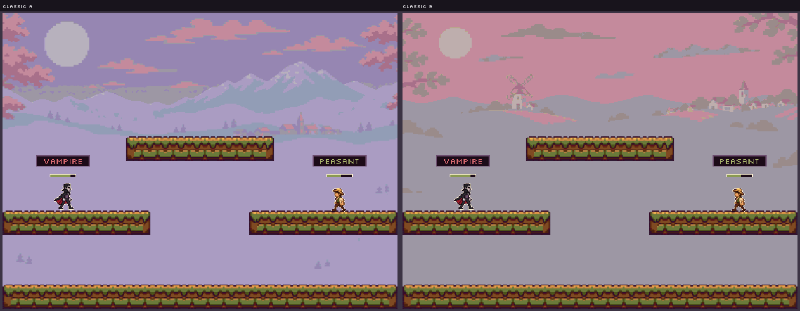

Buttons, panels, cards, cursor and countdown (two button styles and two frame styles, A is the
default):

Fonts (A is the default):

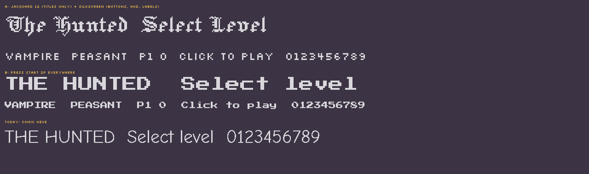

Every generated asset in one picture:

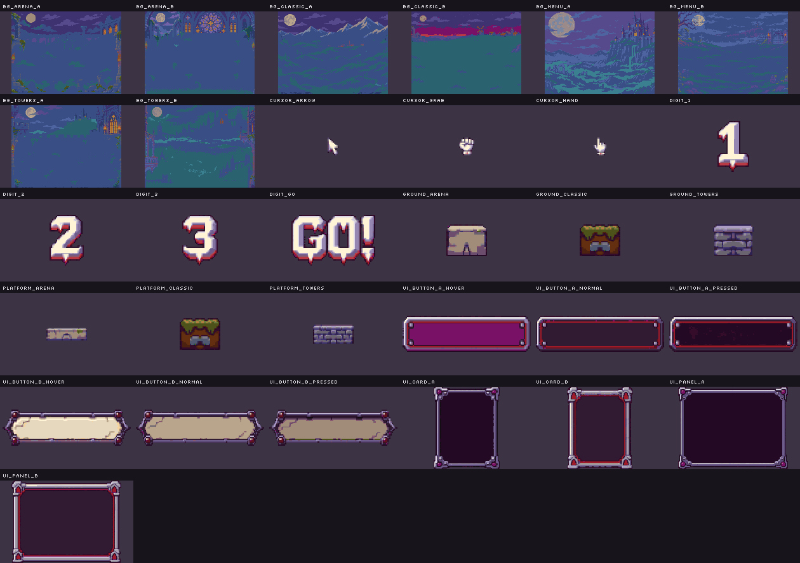

## Mockups, today versus proposed

Today is a screenshot of main as it was; the mode menu, credits
and web popup are the pages of #18 and the browser build and do not exist yet, so they only show
the proposal (the mode menu shows today's main menu for reference).

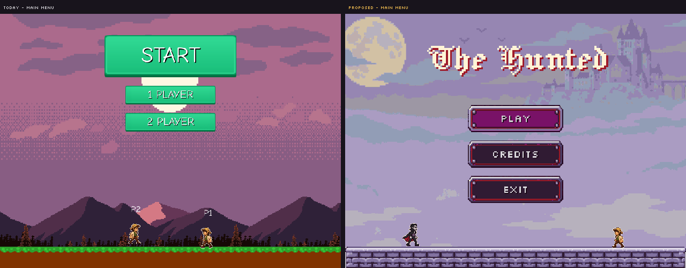

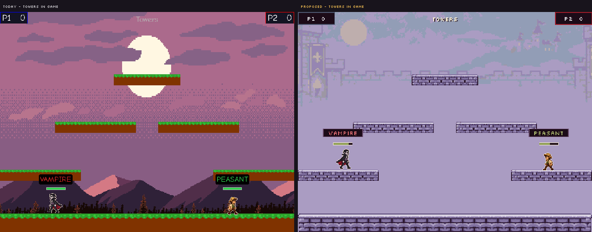

## Decision

The owner picked (2026-11-20, recorded on #19): backgrounds menu A, Classic B, Towers A and
Arena B; buttons and frames A (forged iron); fonts A (Jacquard 12 for titles only, Silkscreen for
buttons, HUD and labels); scenery and UI at 2x with the characters at 1x; keep the sandstone Arena
platforms (checked against Arena B in the game: they stay readable thanks to their dark outline).

## Rejected attempts along the way

- **Pass 1: pale backgrounds (rejected by the owner: too bright).** The first readability rule
  was "lighter and duller than the characters", which made every background a pale lilac with a
  band luma of 154 to 166. Once PR #16 gave the characters a light outline that was no longer
  needed. Pass 2 redid all 8 backgrounds as night scenes (new prompts, night ramps, a luma band
  held to about 68 to 125 in the standing band) and dimmed the platforms:

  
  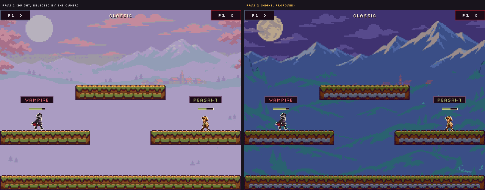

  (The pass 1 halves were cut from the pass 1 mockups; the pass 1 assets are gone.)
- **Ungraded backgrounds.** The first test picture (a castle courtyard at night) was beautiful but
  dark with black walls; the dark vampire would vanish in it. Hence the readability paragraph in
  the prompts and the grading step.
- **Jacquard 12 for everything.** The blackletter caps in "THE HUNTED" and on the buttons were
  unreadable, so it is for mixed-case titles only. Its digits are also hard to read, so the HUD
  uses Silkscreen.
- **Raw 1536x1024 pictures at 1x.** AI "pixel art" does not keep a true pixel grid, so downscaling
  to 800x600 gave mush; working at 400x300 and enlarging 2x keeps hard edges.
- **Separate parallax layers.** Not attempted: the map never scrolls, so layers add nothing, and
  composed scenes read better than re-randomized layers.

## Known issues

- The lower half of the backgrounds is calm by design (readability); in the B candidates it is a
  large, fairly flat teal area. A further pass could add more texture there.
- The peasant's body is the same value as the backgrounds (luma about 80); he reads by his warm
  hue and the outline, so warm-colored backgrounds near him would hurt.
- Arena platforms are only 10 art pixels tall, so the detail is minimal there.
- The 3-slice middle is a patch plus its mirror, so very long platforms show a mirrored pattern.

## Result

The raw Codex pictures (about 1.3 MB each) are not committed; only the final assets, the
prompts and the scripts are.

31 candidate images in `assets/images/style/`, three OFL fonts in `assets/fonts/`, all listed in
`assets/SOURCES.yaml` (AI-generated with OpenAI Codex, not CC0, approved by the owner on
2026-11-20). Phase 2 swaps the picked assets in and removes the rest.

## Phase 2: the picks in the game

Closes #19. What changed in the game, with real screenshots (before is main as it was, after is
this branch; both are the actual game drawn headless):

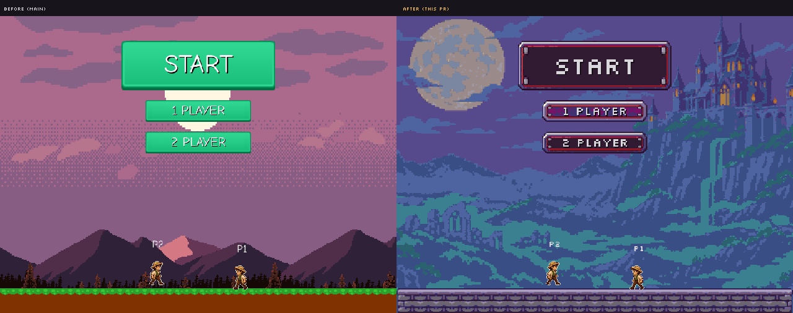
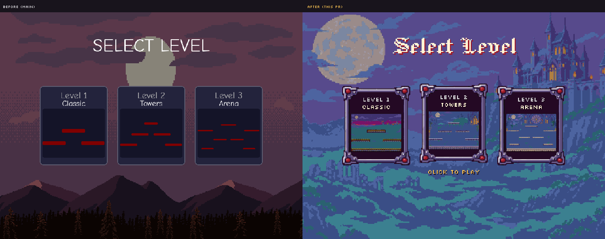
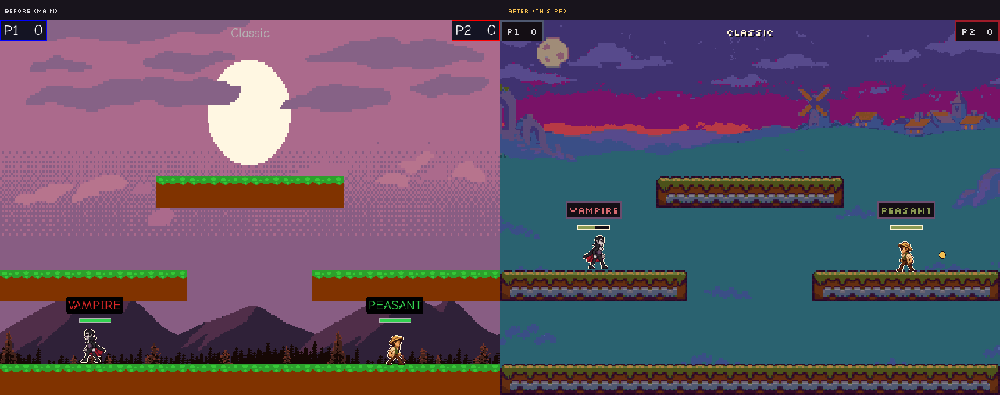
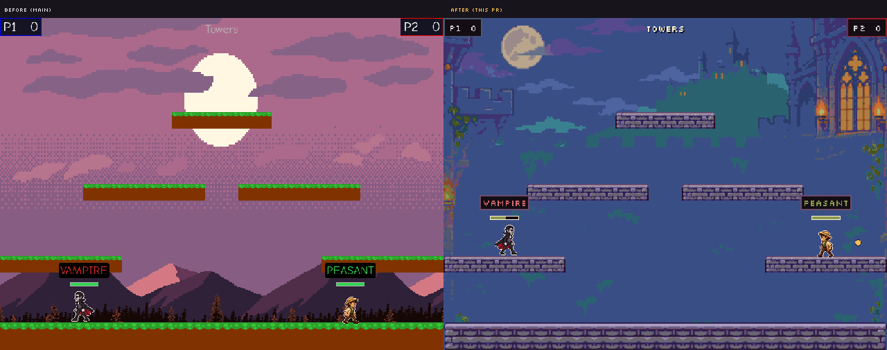
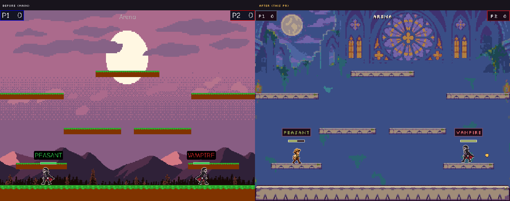

- **Backdrops:** `ParallaxBackground` (baked from five mountain layers, re-randomized each round)
  is replaced by `background.load_background`: one finished picture per level and for the menu.
  `settings.LEVELS` gained `background` and `style` keys; the menu uses `MENU_BACKGROUND` and
  `MENU_STYLE`. The old `bg_layers`, `platfor_tile.png` and their packs are gone.
- **Platforms and ground:** `entities.Platform` draws the level's 3-slice art at any width
  (`pixelart.three_slice`) instead of tiling a square grass tile; `entities.level_platforms`
  builds a level's platforms. The ground is the same art at 800x50.
- **Buttons:** the Kenney buttons are replaced by the iron buttons, stretched with
  `pixelart.nine_slice`; labels are Silkscreen. The menu keeps today's structure (START, 1 PLAYER,
  2 PLAYER); the PLAY/CREDITS/EXIT pages are card #18.
- **Cursor:** arrow, pointing hand and grabbing hand replace the Kenney cursors. The unused HELP
  and WRITING states are gone (nothing used them).
- **Countdown:** the ring-and-digit graphic is replaced by the glyph art, 3, 2, 1, GO. The old
  sequence had a 0 between 1 and GO; there is no glyph for it, so the four steps are 15 frames each
  (the total stays 60 frames). Each glyph drops in over its first five frames.
- **Level select:** cards use the frame art and show a preview of the whole level (backdrop,
  ground, platforms) instead of red bars; a hovered card lifts and shows "CLICK TO PLAY".
- **HUD:** score plates, role tags and health bars are drawn in code with the palette: ink plates
  with a 2 px edge, a bar outlined in the characters' rim color, Silkscreen text. Health bar colors
  (moss, gold, rose) replace the old pure green, yellow and red.
- **Bullets:** the peasant's bullets were black, which disappears on the dark backdrops; they are
  gold with an ink outline now (`settings.BULLET_COLOR`). Size, speed and hitbox are unchanged.
- **Fonts:** Jacquard 12 for titles, Silkscreen for the rest, without anti-aliasing and at whole
  multiples of their pixel grids. Comic Neue is gone.
- **Browser loader page:** `web/template.tmpl` uses the palette (ink plate, rim-colored title on a
  crimson shadow, gold prompt, grass-colored bar); the contrast tests still require 7:1. The title
  keeps the Impact stack: a pixel web font would have to be shipped and loaded before the page
  shows.
- **Media:** `scripts/art_gen/make_media.py` retakes the README screenshots and `docs/preview.gif`
  at 1920x1080 (the game at 1440x1080 with black bars, like the real window) and makes the two
  store covers from the new art (2752x1536 and 630x500). The old cover had a third-party character
  and is gone. Everything unused was removed from `assets/`, `SOURCES.yaml`, `licenses/assets/` and
  CREDITS.md: the CC0 mountain layers, the grass tile, the Kenney UI and cursor packs, Comic Neue,
  and the unpicked candidates (Press Start 2P, the B button and frame set, the other backdrops).

Not changed: gameplay, physics, hitboxes, the AI, the music and sounds.

## Phase 2b: 16:9

The owner approved the look and asked for 16:9 and 1080p. The game now draws on a **960x540**
canvas instead of 800x600. Everything is in this PR (still #19).

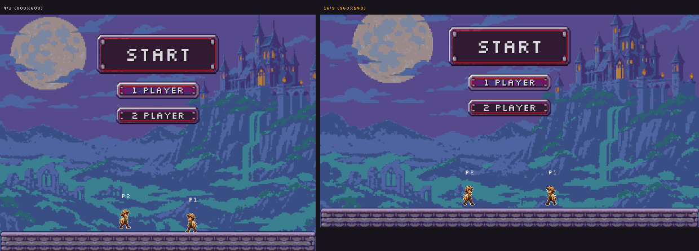
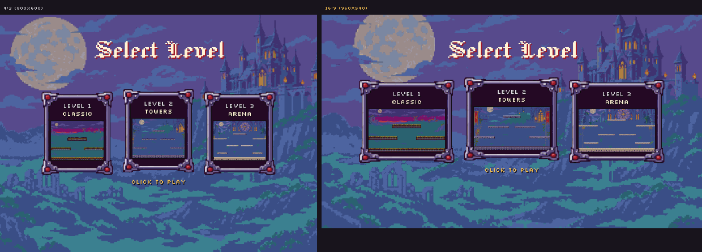
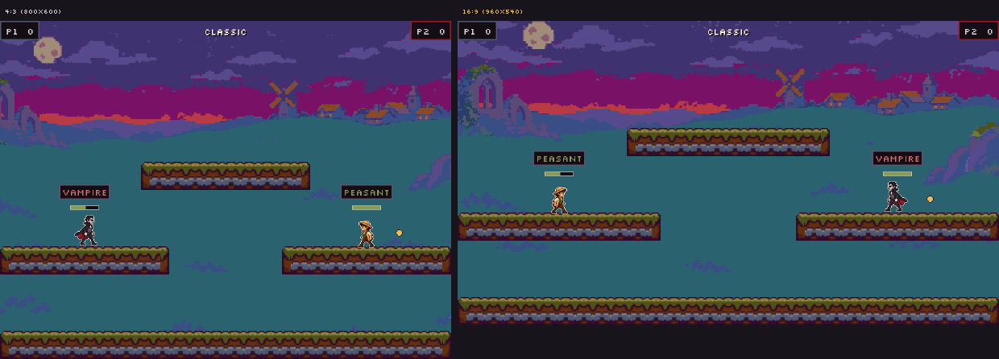
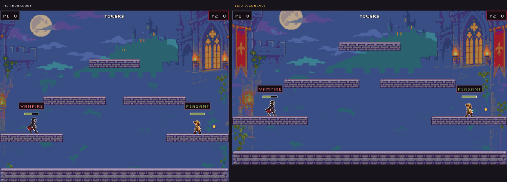
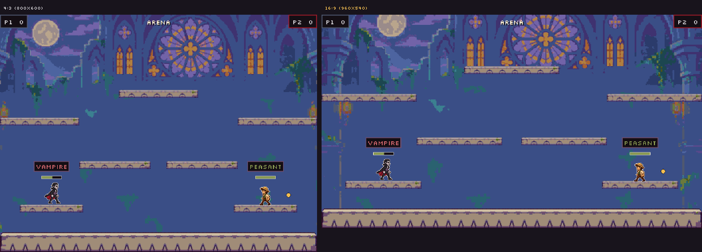

- **Canvas and scaling.** pygamine's `Display` (`fixed_aspect=True`) keeps the 960x540 canvas and
  scales it with `pygame.transform.scale`, which is nearest-neighbor, into a centered rect on the
  window, filling the rest with black. Fullscreen on a 1920x1080 screen is therefore an exact 2x
  with no blur (3840x2160 is an exact 4x), and the README screenshots and preview.gif are the
  canvas at exactly 2x. Other screen sizes still get hard pixels but an uneven pixel width
  (for example 2.67x on 2560x1440). Whole-number-only scaling would be an engine change in the
  shared pygamine submodule, so it is a separate card. The default windowed size is the canvas size
  (960x540, which fits any 1080p screen with its title bar, and pygamine shrinks it only on smaller
  screens); a 1920x1080 window would not fit with the taskbar. F11 cycles fullscreen, borderless
  and windowed as before.
- **Backgrounds.** The four picked pictures are the same Codex generations, now cropped to 16:9
  from the full width of the 3:2 originals (before they were cut to 4:3 from the middle) and graded
  the same way, so the look is unchanged and the sides show more scenery. Art pixel size is still
  2x2 screen pixels (the art is 480x270). The readability check holds (standing band, nothing
  near-black, no red).
- **Heights.** The ground strip is still 50 px, now at y 490 (`settings.GROUND_Y`), so the whole
  scene moved up 60 px: `FLOOR_Y` 430 and every platform 60 px higher. Every vertical step is
  therefore the same as before.
- **Levels.** Platform x positions and widths are stretched 1.2x so the platforms span the whole
  960 px and stay symmetric: Classic (0 to 360, 600 to 960, and the top one 300 to 660), Towers
  (264-wide low and mid platforms, a 216-wide top one) and Arena (the low platforms 192 wide, 60
  px in from the edges, the others 216 to 240). Judgment calls: the Arena's low platforms keep
  their 60 px inset like before; the gaps between platforms grew by 20% but stay far below the
  jump's reach (about 275 px for the peasant, 358 for the vampire), and the highest platform is
  150 px above the ground, under the jump's 189 px apex.
- **Checks.** `tests/test_levels.py` measures the real jump arc from the game's physics and runs a
  reachability search on every level for both characters (including the screen wrap), checks the
  layouts stay inside the canvas and symmetric, and plays two AIs against each other on every
  level: rounds keep ending, none drags on, and the chaser is never stuck. In a longer run (3
  seeds x 30000 frames per level) the new layouts behave like the old: 160 to 180 rounds on Classic
  and Towers, 107 to 133 on Arena (the old Arena: 117 to 142), longest round 2344 frames (old:
  3817).
- **Everything else follows the canvas:** the menu buttons and the countdown glyph moved to the
  new center (the START block keeps its distance from the top), level-select cards are 240x210 so
  their previews are 16:9, the HUD plates anchor to the new corners, `combat.begin_round` spawns
  at the new center and bullets leave at the new edges (all of these already read
  `window_w`), and the intro-jump gate is `FLOOR_Y - 150` instead of a literal 340. The browser
  page asks for a 960x540 canvas (`web/template.tmpl`), and CONTRIBUTING.md names 960x540 as the
  itch.io embed size. The web bundle was built and opened in a desktop browser (Edge, via
  Playwright): it boots, shows the 16:9 menu and scales it to the page.

