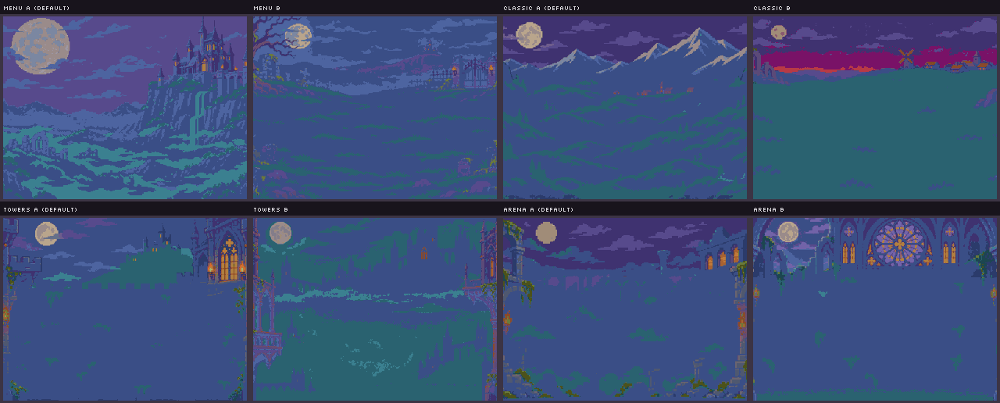
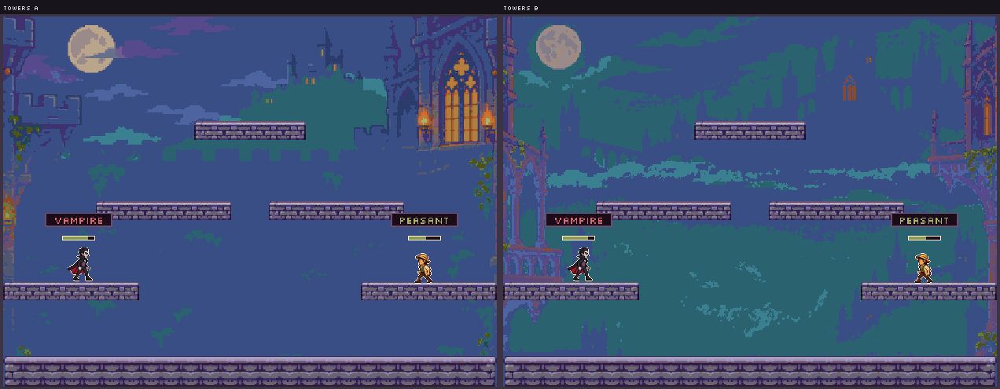
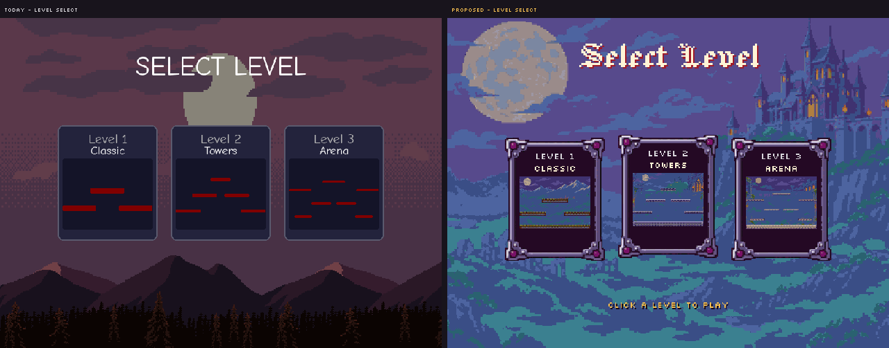
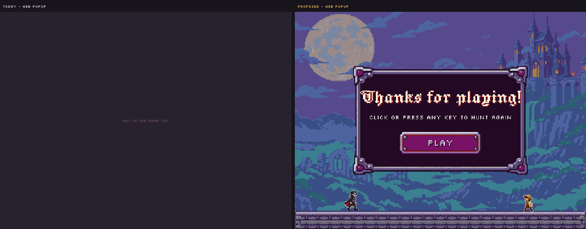
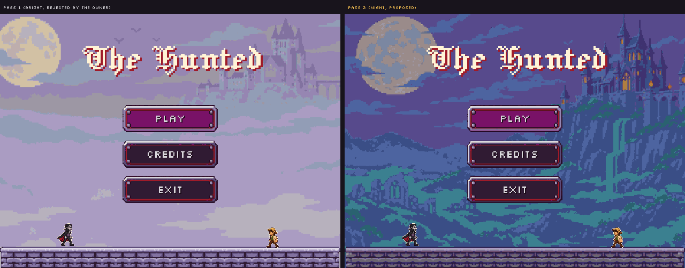

# One art style: guide and generated candidates
<!-- index | refs: #19 -->

**Date:** 2026-11-20 · **Area:** Art · **Issue:** [#19](https://github.com/vectorviolet/hunted/issues/19)

This is phase 1 of #19: a style guide and generated candidates for the owner to pick from. No game
code changed and none of the new assets is wired in. The style guide is
[`docs/design/art-style.md`](../design/art-style.md).

## Context

The new characters (#8) and icon A (#9) are pixel art in a dark gothic palette, but the rest of
the game is a CC0 mountain parallax, a green-grass tile, Kenney's green buttons and Comic Neue.
The owner's priority: one consistent style everywhere, and characters that stand out from every
background (light outline; separation by outline, hue and value; no near-black at standing height).

## Approach

1. Read the palette off the sprites and the icon (the "core" ramps), then add "scenery"
   ramps (night blue, teal, violet, plus lighter ones for platforms and UI) in the same hue
   families: 82 colors in `scripts/art_gen/palette.py`.
2. Generate each piece with Codex image generation (`codex exec`), with the vampire sheet, the
   peasant sheet and icon A attached as style references. Every prompt is in
   `scripts/art_gen/prompts.py`; they share one style paragraph and, for backgrounds, one
   readability paragraph (night mood, mid-dark cool values, no near-black or red in the middle).
3. `scripts/art_gen/process.py` cleans each picture up: crop to 4:3, grade into the night luma band
   (40 to 170, held to about 68 to 125 in the standing band), snap to the palette with no dithering, remove stray pixels, key out the magenta and
   keep hard alpha, build the 3-slice platform sheets and 9-slice-ready frames, enlarge 2x.
4. `scripts/art_gen/mockups.py` composites the screens from the generated assets, the real
   character frames and the real fonts, next to screenshots of current main.

Style reference prompt (shared by every job):

> Crisp retro pixel art in exactly the style of the attached reference images (the vampire and
> peasant walk sheets and the vampire face icon): hard pixel edges, NO anti-aliasing, no blur, no
> gradients, no dithering noise, no painterly texture, a small limited palette (violet-black, deep
> purple, deep blue, teal, bone white, crimson, warm torch orange, straw gold, moss green,
> brown). Light comes from the upper left (the moon). No text, no letters, no people, no
> creatures, no watermark.

Background rule paragraph, pass 2 (appended to each scene description):

> ... Night or deep-dusk mood, mid-dark values with real saturation: deep blue, teal and violet,
> with a pale moon and a few warm lights. Between 40% and 90% of the height keep the values
> mid-dark: NO near-black shapes, no saturated red or crimson near the middle (red is reserved for
> the vampire). Strong detail in the upper part and at the far left and right edges; the middle
> stays calm but is a rich cool color with soft texture. ...

## Candidates

Backgrounds, two moods per screen (A is the default):

Each level with its platforms, ground and both characters, A left and B right:

Buttons, panels, cards, cursor and countdown (two button styles and two frame styles, A is the
default):

Fonts (A is the default):

Every generated asset in one picture:

## Mockups, today versus proposed

Today is a screenshot of current main (`scripts/art_gen/shoot_today.py`); the mode menu, credits
and web popup are the pages of #18 and the browser build and do not exist yet, so they only show
the proposal (the mode menu shows today's main menu for reference).

## Decision

Open: the owner picks. Defaults (chosen by Claude as the starting point, night pass): background A for every
screen, button and frame style A, fonts A (Jacquard 12 for titles only plus Silkscreen), 2x pixel
scale for scenery and UI.

## Rejected attempts along the way

- **Pass 1: pale backgrounds (rejected by the owner: too bright).** The first readability rule
  was "lighter and duller than the characters", which made every background a pale lilac with a
  band luma of 154 to 166. Once PR #16 gave the characters a light outline that was no longer
  needed. Pass 2 redid all 8 backgrounds as night scenes (new prompts, night ramps, a luma band
  held to about 68 to 125 in the standing band) and dimmed the platforms:

  
  

  (The pass 1 halves were cut from the pass 1 mockups; the pass 1 assets are gone.)
- **Ungraded backgrounds.** The first test picture (a castle courtyard at night) was beautiful but
  dark with black walls; the dark vampire would vanish in it. Hence the readability paragraph in
  the prompts and the grading step.
- **Jacquard 12 for everything.** The blackletter caps in "THE HUNTED" and on the buttons were
  unreadable, so it is for mixed-case titles only. Its digits are also hard to read, so the HUD
  uses Silkscreen.
- **Raw 1536x1024 pictures at 1x.** AI "pixel art" does not keep a true pixel grid, so downscaling
  to 800x600 gave mush; working at 400x300 and enlarging 2x keeps hard edges.
- **Separate parallax layers.** Not attempted: the map never scrolls, so layers add nothing, and
  composed scenes read better than re-randomized layers.

## Known issues

- The lower half of the backgrounds is calm by design (readability); in the B candidates it is a
  large, fairly flat teal area. A further pass could add more texture there.
- The peasant's body is the same value as the backgrounds (luma about 80); he reads by his warm
  hue and the outline, so warm-colored backgrounds near him would hurt.
- Arena platforms are only 10 art pixels tall, so the detail is minimal there.
- The 3-slice middle is a patch plus its mirror, so very long platforms show a mirrored pattern.

## Result

The raw Codex pictures (about 1.3 MB each) are not committed; only the final assets, the
prompts and the scripts are.

31 candidate images in `assets/images/style/`, three OFL fonts in `assets/fonts/`, all listed in
`assets/SOURCES.yaml` (AI-generated with OpenAI Codex, not CC0, approved by the owner on
2026-11-20). Phase 2 swaps the picked assets in and removes the rest.
