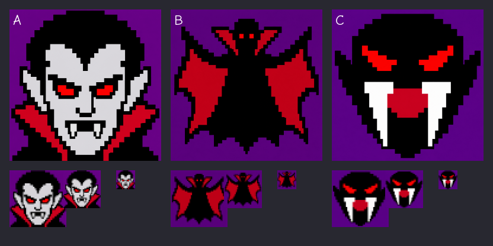
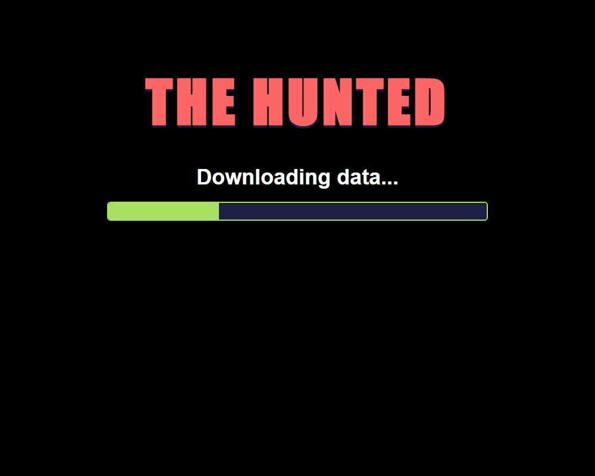
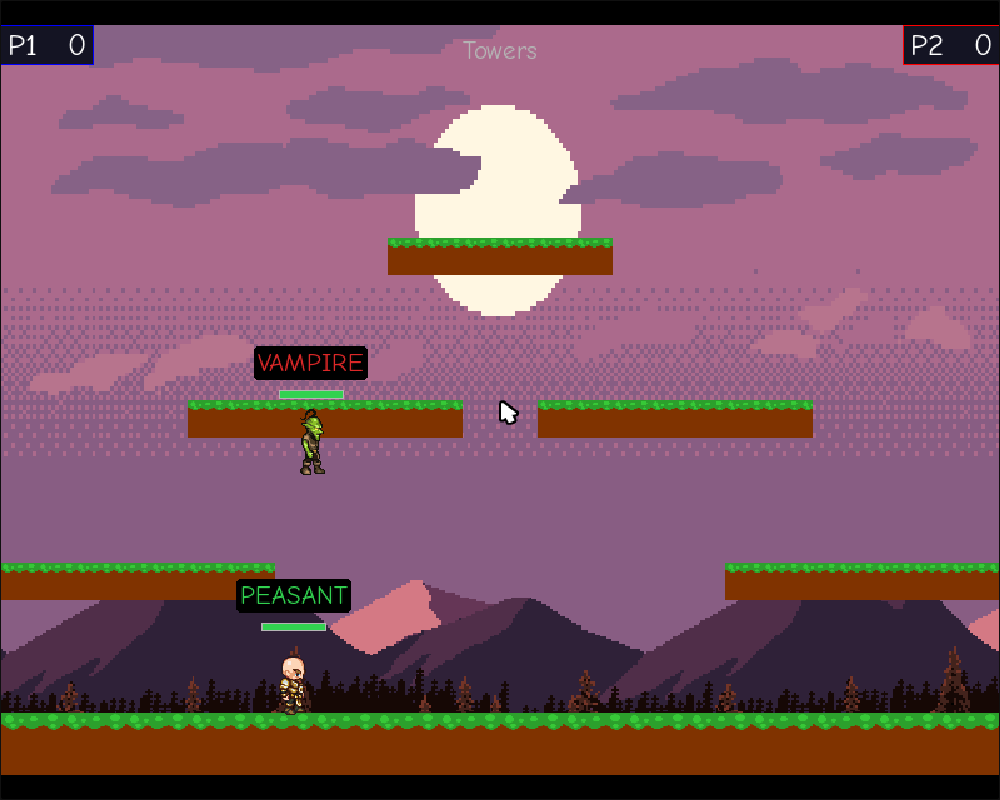

# Browser build and Windows installer
<!-- index | refs: #9, PR #17 | area: Web, packaging -->

**Date:** 2026-11-20 · **Area:** Web, packaging · **Issue:** [#9](https://github.com/vectorviolet/the-hunted/issues/9) · **PR:** [#17](https://github.com/vectorviolet/the-hunted/pull/17) · **ADR:** [0001](../decisions/0001-web-build.md)

## Context

Hunted's releases had desktop zips and itch.io channels only. Highrise and Chokepoint also ship an
itch.io browser build and (Highrise) a Windows installer. Part of bringing Hunted up to the
project standard.

## Options

- **Splash in the browser:** keep it (needs threads and a video decode the runtime can't do) or
  skip it. Skipped.
- **Loading logo:** the store cover (4.5 MB, shows Pikachu, a third-party character) or the title
  as text. Text.
- **App icon:** none exists. The cover is out for the same reason; a Kenney cursor is only 32 px.
  A first placeholder was a letter drawn from the font; the owner then asked for AI-generated
  art in the new pixel-art style (see below).
- **Build recipe:** write a new one or fork Highrise's, which Chokepoint's also matches. Forked.

## Decision

Port Highrise's recipe (details and the full list of choices in [ADR 0001](../decisions/0001-web-build.md)). What differed:

- Hunted has no saves, config or PyYAML, so the staging is smaller (about 200 files, 5.4 MB packed),
  and CREDITS.md, LICENSE and `licenses/` go into the bundle as in the desktop zips.
- The only change to the game is that the browser skips the threaded splash. Everything else ran
  unchanged under pygbag.
- The icon is AI-generated (see "The icon" below). One picture feeds the installer's multi-size
  `.ico` (also the exe's icon), the page's favicon and the window icon, all made by
  `scripts/make_icon.py`.
- The installer is Highrise's Inno Setup script with a new AppId, English and Turkish setup
  languages, and no save-data notes.

## The icon

Three candidates made with OpenAI Codex image generation (`codex exec`), with the vampire
sheet from the sprite PR as style reference. Candidate A is the default; the owner picks. Rows
below the big image show 48, 32 and 16 px (enlarged 2x so the real pixels are visible).

Prompt (concept varies):

> Square game app icon, 1024x1024, crisp retro pixel art in the style of the attached sheet,
> 1 px dark outline, no anti-aliasing, limited palette (black, gray-white, crimson, purple). Bold
> and readable at 16x16 and 32x32: one big simple shape, strong silhouette, high contrast, no
> text, solid dark background filling the square.

- **A:** the vampire's face, front view, red eyes, fangs, crimson collar. Default: it reads as
  the vampire at 32 px and matches the sprite.
- **B:** a bat-winged cape silhouette with two red eyes. Strong shape, but the eyes vanish at 16 px.
- **C:** a black face with red eyes and big white fangs. Bold, but less recognizably the vampire.

To switch: `uv run python scripts/make_icon.py b` (or `c`) rewrites the three icon files.
The files are listed in `assets/SOURCES.yaml` as AI-generated, pending the owner's approval.

## Rejected alternatives

- Shipping the store cover as logo or icon: not cleared for redistribution.
- Changing Escape on the menu for the browser (it ends the loop and freezes the page): a design
  decision for the owner, so left as on desktop.

## Result

Built and played locally in Edge through `python -m http.server`: loader, menu, level select, a
round with keyboard input all work.

| Loading page | A round in the browser |
|---|---|
|  |  |

The installer itself is built only by the release workflow (Inno Setup on a Windows runner), so
it is first exercised by the next tagged release or a manual workflow run.
