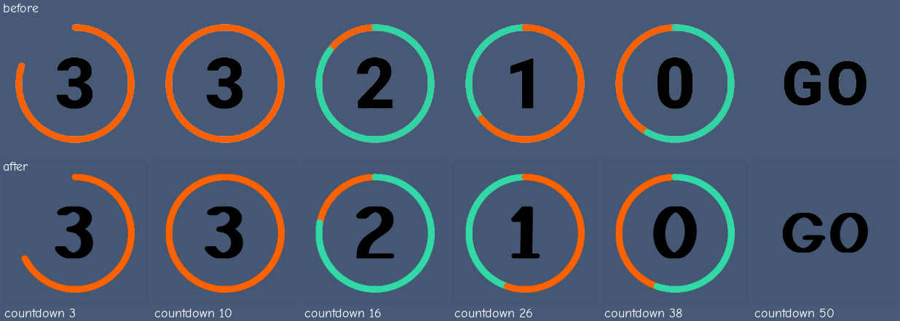

# Drawing the pre-game countdown in code

2026-11-20

## Context

The countdown before a round (3, 2, 1, 0, GO) played 49 PNG frames from `assets/images/wait/`.
They were cut out with remove.bg from a source nobody remembers, so their license is unknown.
Hunted is being brought up to the project standard, where every asset has a known license.

## Options

1. Find or redo the frames with a licensed source. Still 49 binary files for what is a ring and a
   number, and the source would need tracking.
2. Draw it in code with the bundled Comic Neue (SIL OFL) and `pygame.draw.arc`.

## Decision

Option 2 (owner, 2026-11-20). The look and timing stay the same: a ring around the digit fills
clockwise from the top, alternating orange and teal each second, then "GO" without a ring.

How the frames were read, to keep the same behavior:

- Each digit (3, 2, 1, 0) lasts 12 frames, then "GO" for 12 frames (countdown 48-59).
- The ring color alternates orange, teal, orange, teal. From the second digit on, the previous
  second's full ring sits underneath and the new color sweeps over it.
- The sweep eases out: roughly 25% at the first frame of a digit, full after about 9 frames.
- Colors sampled from the PNGs: orange `(255, 100, 0)`, teal `(52, 219, 169)`, black text.
- Same place and size: 300x300 at (250, 30). The ring is drawn at 2x and scaled down for smooth
  edges, with round caps like the originals.

The pure logic (`countdown_step`) is separate from the drawing so it can be tested without a window.

## Rejected alternatives

- Keeping the frames and only documenting them: the license is unknown, so no.
- Drawing the ring without supersampling: `pygame.draw.arc` is not anti-aliased and the thick ring
  looked jagged.

## Result

Close to the original. Differences: Comic Neue's bold (synthetic, since only the regular weight is
bundled) is rounder than the Roboto-like digits in the old frames, and "GO" is slightly smaller to
keep its width the same. The 49 PNGs are removed.
