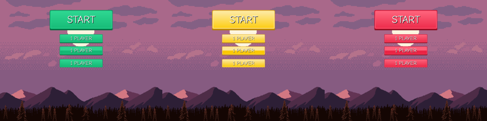
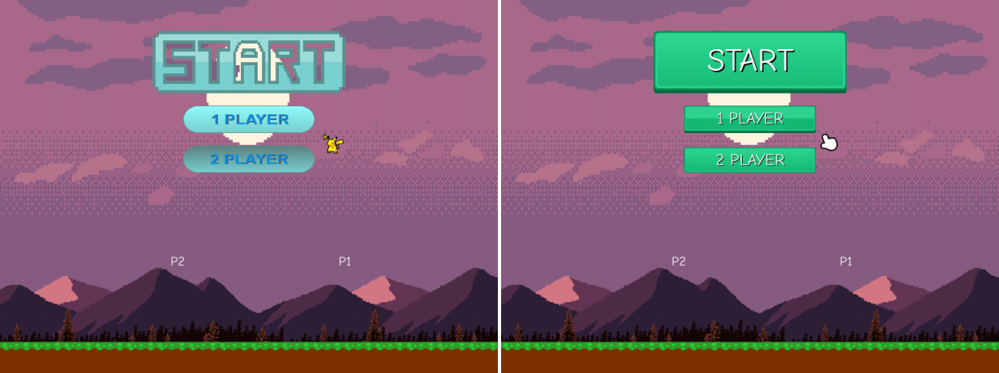

# Kenney buttons and cursor

2026-11-20

## Context

The three menu buttons came from an online button generator and a free-PNG site, and the mouse
cursor was 52 animated frames of a Pikachu cursor with no source. Neither has a license we can
verify, so the owner decided on 2026-11-20 to replace both with CC0 art. Hunted's sibling game
Highrise already uses Kenney's UI Pack and Cursor Pack, so the look stays in the family.

## Options

The UI Pack buttons come in several colors. The three that stand out against the dusk background,
side by side (raised, hover, pressed for the 1 PLAYER button, with the START button on top):

1. Green: strong contrast against the purple sky and the cream sun, white label stays readable.
2. Yellow: the warmest match for the sun, but the white label is hard to read; it would need a
   dark label, which looks heavy on the small buttons.
3. Red: close to the pink mountain tops, so the buttons blend in.

## Decision

Green. It is the most readable and does not clash with the background. The owner can veto the
color while play-testing: it is only the three PNGs in `assets/images/buttons/`, copied from
another color folder of the UI Pack (the filenames are the same in every color).

- The labels ("START", "1 PLAYER", "2 PLAYER") are drawn in Comic Neue by `src/buttons.py` on top
  of the button art, so the label text and font are not baked into any image.
- The pack's 192x64 buttons are resized to the old sizes (310x100 and 212x44) in three pieces: the
  rounded ends keep their proportions and only the middle is stretched.
- States: normal is the raised gradient button, hover is the glossy raised one, pressed is the
  flat button drawn lower by the height of the raised buttons' bottom edge, so the whole face drops (the label with it). START has all three states too.
- Cursor: one static image per state instead of 17 + 8 + 13 animated frames. Normal is the
  arrow, `click` (over something clickable) the pointing hand, `click2` (pressed) the closed hand,
  `help` the arrow with a question mark and `writing` the I-beam. Each image has a hotspot, so the
  arrow's tip, not the corner of the image, is where the mouse is.
- `Cursor` has a small public API (`set_state`, `state`); the menu and the level select no longer
  poke at its private frame lists.

## Rejected alternatives

- Baking the labels into new PNGs: would add generated files to maintain; drawing them keeps the
  font in one place.
- Keeping an animated cursor: the pack has no frame sets, and the animation was Pikachu's.

## Result

Left: before (generator buttons, Pikachu cursor). Right: after (Kenney buttons, pointing-hand
cursor over the hovered 1 PLAYER button, 2 PLAYER shown pressed). `assets/SOURCES.yaml` lists the
Kenney files and the old files are gone.
