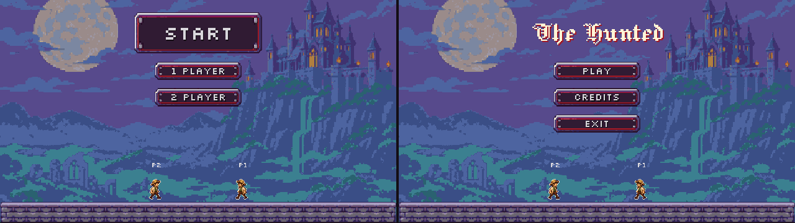
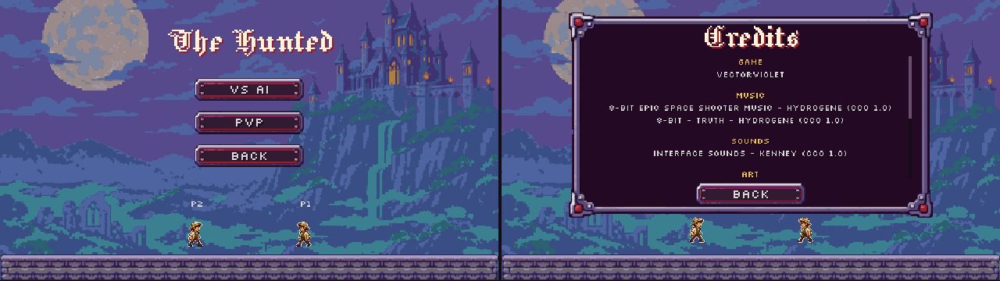
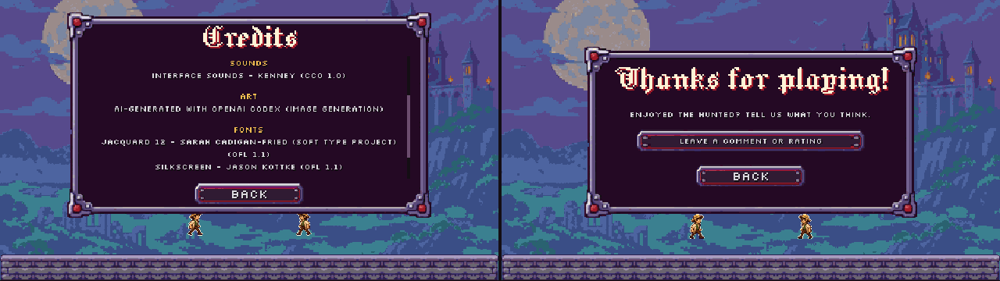
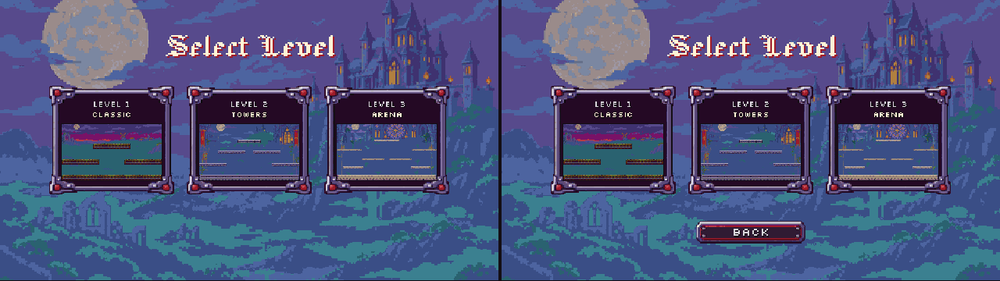

# Main menu pages: play, credits and exit
<!-- index | refs: #18, PR #23 | area: UI -->

**Date:** 2026-11-20 · **Area:** UI · **Issue:** [#18](https://github.com/vectorviolet/hunted/issues/18) · **PR:** [#23](https://github.com/vectorviolet/hunted/pull/23)

## Context

The menu was one screen: a big START button with 1 PLAYER and 2 PLAYER toggles under it. There was
no credits page and no exit button, and Esc quit the game. In the browser build that last part is a
bug: a page can't be closed by the game, so Esc froze the canvas (noted on #17). The owner asked
for proper pages with back buttons (#18) once the art pass (#19) had given the game one look.

Before and after, the main menu:

## Decision

The spec is the owner's (2026-11-20); the details below are what the implementation settled.

- **Main menu:** PLAY, CREDITS, EXIT. The intro jump and the P1 / P2 tags stay on it.
- **PLAY opens the mode menu:** VS AI (the old 1 PLAYER), PVP (the old 2 PLAYER, local) and BACK.
  Picking a mode starts the countdown and then the level select, as before. The mode used to be a
  toggle you could change after pressing START; now it is the choice that starts the game.
- **Credits:** built from `assets/SOURCES.yaml`, the same data `CREDITS.md`'s asset table is
  generated from, so the page can't drift from it. `scripts/gen_credits.py` writes the text to
  `src/credits_data.py` and the game imports that; a test fails when it is out of date. Sections: game
  (VectorViolet), music, sounds, art, fonts, engine. A pack lands in a section by where its files
  live (`fonts/`, `images/`, `sounds/`; a sounds pack whose `used_for` says music is music). It
  doesn't fit the panel, so it scrolls with the mouse wheel and the Up and Down arrow keys, with a
  scroll bar on the right.
- **BACK and Esc:** the mode menu, credits and level select have a BACK button; Esc does the same.
  One page up: level select to the mode menu (the menu music starts again and the players are reset
  like before), everything else to the main menu. Esc during the countdown cancels it and returns
  to the main menu.
- **EXIT:** quits on desktop. In the browser build, EXIT and Esc on the main menu open the "Thanks
  for playing" popup (as in Chokepoint and Highrise): a title, one line, a "leave a comment or
  rating" button that opens the itch.io page in a new tab, and BACK. Esc closes it. Desktop Esc on
  the main menu still quits.
- **Look:** no new art. The iron buttons, `images/ui/panel.png` (it was reserved for these panels)
  for the credits and the popup, Jacquard 12 for titles, Silkscreen for text, the palette colors.
  Everything is laid out on the 960x540 canvas.

The new pages (left: the mode menu, right: the credits):

Left: the credits scrolled down. Right: the web popup:

The level select gets its BACK button under the cards (before left, after right; the right shot
has the second card hovered):

## Rejected alternatives

- **A separate screen state per page.** `STATE_MENU` keeps one `Menu` with a `page`; the pages
  share the backdrop, the players and the cursor logic, and the countdown runs on the mode page.
- **Hand-written credits text.** It would have to be kept in step with `SOURCES.yaml` and
  `CREDITS.md`.
- **Reading `SOURCES.yaml` at runtime.** It needs PyYAML, which the browser build doesn't have.
- **Fitting the credits by shrinking the font.** Silkscreen only looks right at whole multiples of
  16 px, so the text scrolls instead.
- **Keeping the 1 PLAYER / 2 PLAYER toggles on the main menu.** The owner asked for the mode menu.

## Result

The game needs no YAML library at runtime: the first version read `SOURCES.yaml` when the menu
loaded, and the browser build crashed at startup because pygbag doesn't install PyYAML from the
entry point's dependency header. The credits text is now generated at development time instead (a
test boots the browser-mode game with `yaml` blocked). `util.web.open_in_new_tab` is new. The
README screenshots, the preview and the store media still show the old menu; retaking them is #22.
