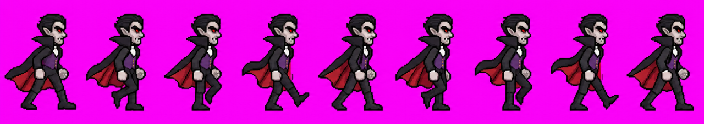
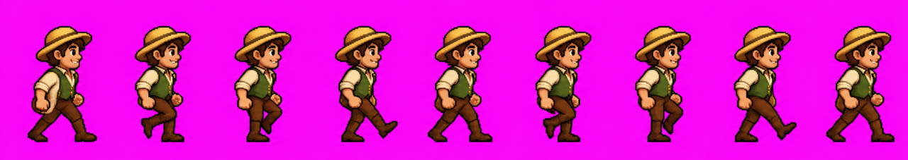
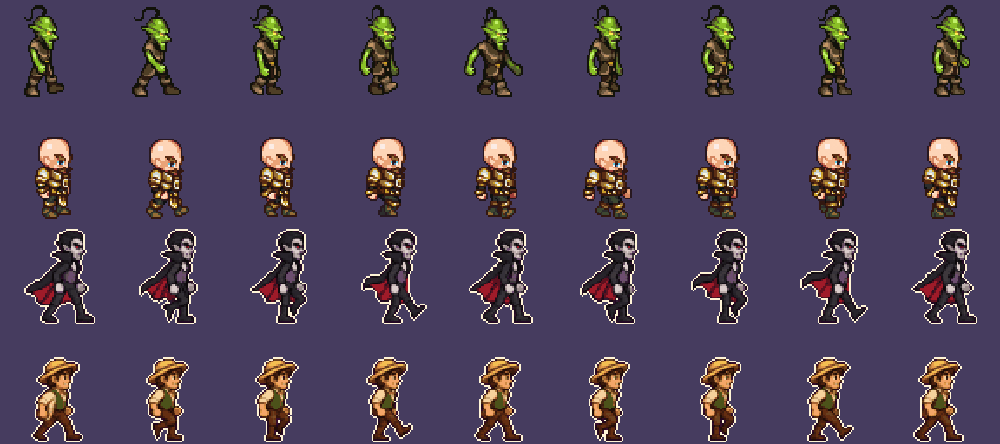
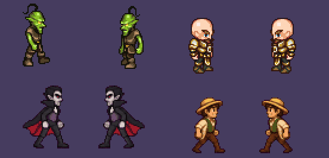
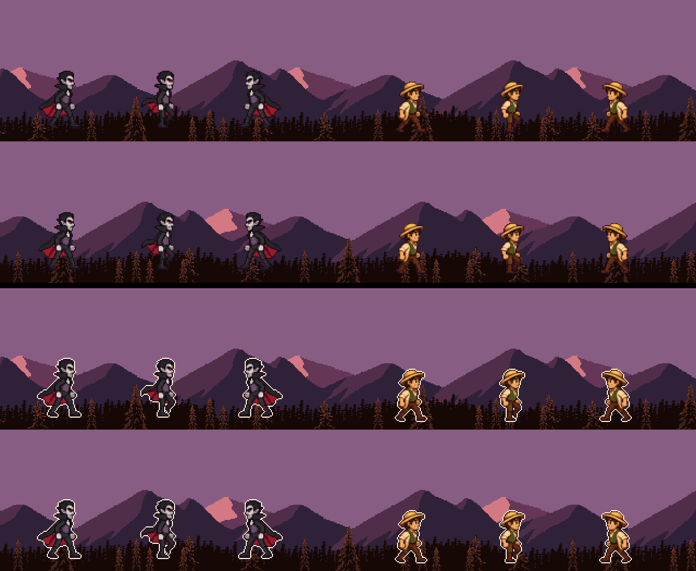

# New pixel-art vampire and peasant
<!-- index | refs: #8 -->

**Date:** 2026-11-20 · **Area:** Art · **Issue:** [#8](https://github.com/vectorviolet/hunted/issues/8)

## Context

The vampire sprites had no known source and the peasant was Redshrike's LPC "Baldric" (CC BY 3.0).
The two did not match either: a green goblin-like creature next to a bald knight in gold armor. The
owner decided on 2026-11-20 to replace both with new art in one style, made with AI image generation
(Codex), as for Highrise's icon. The lead fixed the style: pixel art, 64x64 frames, LPC-like
proportions, so `src/entities.py`, the animation and the hitboxes stay as they are.

Before: 9 walk frames per direction for each character, `R1E.png`..`R9E.png` / `L1E.png`..`L9E.png`
for the vampire and `R1.png`..`R9.png` / `L1.png`..`L9.png` for the peasant (plus an unused
`peasant/standing.png`, now removed). Only left and right exist; the game never shows front or back
views.

## Approach

One sprite sheet per character, so the character stays the same in every frame, then a script
(`scripts/slice_character_sheets.py`) turns each sheet into the game's frames:

1. Ask Codex for one row of 9 right-facing walk frames on a flat magenta background.
2. Key out the magenta, cut the 9 frames, scale each character by one factor (vampire 53 px tall,
   peasant 47 px, close to the old frames).
3. Hard alpha (0 or 255) and a 20-color palette per character (median cut), so there is no
   anti-aliasing left.
4. Put every frame on the same baseline (feet at row 58 for the vampire, 62 for the peasant, like
   the old frames) and at one shared horizontal center per character, the center of that character's hitbox in `src/entities.py`, so the art sits in the unchanged hitbox (`tests/test_sprite_frames.py` checks it).
5. A 1 px pale warm off-white outline (`#FFF4D6`, near the moon color) goes around the whole character. Added after the owner's play-test (see below).
6. The left frames are the right frames mirrored.

The original sheets are kept in `scripts/sheets/` so the script can be re-run.

## Prompts

Vampire (first and only attempt, sheet 1):

> Pixel art sprite sheet of a side-view walk cycle for a 2D platformer. A menacing VAMPIRE, the
> hunter in a chase game: tall, gaunt, pale-gray skin, slicked-back black hair, red eyes, long
> black high-collared cape with crimson lining flowing behind, dark purple vest, black trousers
> and boots, visible fangs. Facing right, strict profile. Exactly 9 frames in one horizontal row,
> equal spacing, same character and palette, smooth walk cycle, feet on one baseline, same size,
> LPC-like chunky proportions, empty space between frames. Crisp retro pixel art, no
> anti-aliasing, no gradients, no ground shadow, 12-16 colors, 1 px dark outline. Flat solid
> magenta #FF00FF background, no text or grid.

Peasant (with the vampire sheet attached as a style reference):

> Match the attached sheet's pixel-art style, outline weight, shading and layout. A PEASANT
> villager, the hunted prey and player-side hero, noticeably shorter and rounder than the vampire
> (about 46 px versus 53), no cape, so the silhouette differs: wide-brimmed straw hat, friendly
> tan face, brown hair, cream linen shirt with rolled sleeves, green waistcoat, brown trousers and
> boots. Warm bright earthy colors (the vampire is dark with purple and red). Same layout, style
> and magenta background rules as the vampire.

## Result

The raw sheets as generated (1881x836):

Old and new frames at 2x, right-facing walk (rows: old vampire, old peasant, new vampire, new peasant):

- The vampire reads as the threat: dark, long cape, red eyes. The peasant reads as the player's
  side: bright straw hat, green vest, shorter, no cape. The silhouettes differ at game scale (cape
  and gaunt build versus round hat and stocky build).
- Same frame names, counts and 64x64 size; the hitboxes are unchanged.
- Rights: AI-generated with OpenAI Codex, listed as `own` with `generated_with` in
  `assets/SOURCES.yaml`, not CC0. The Redshrike LPC pack and its license text are removed because
  nothing else used them.
- The owner approves the art before the PR is merged.

## Outline after play-testing

The owner play-tested the first version: the vampire's dark body blended into the near-black tree
line and the dark purple mountains. Decision (owner): a 1 px light outline around both characters,
all 36 frames, drawn by `scripts/slice_character_sheets.py` (hard alpha, 4-neighbor, so it grows the
frame by 1 px). The background is not touched. Top two strips: before; bottom two: after (the two
strips of each are two random backgrounds, characters standing in front of the tree line, 2x):

The outline also adds a light edge to the peasant, who was already readable.

## Rejected attempts

None. Both sheets were accepted on the first generation; no re-rolls were needed.

## Rejected alternatives

- Generating each frame separately: the character drifts between frames.
- Keeping the Redshrike peasant: it would not match the new vampire (owner decision).
