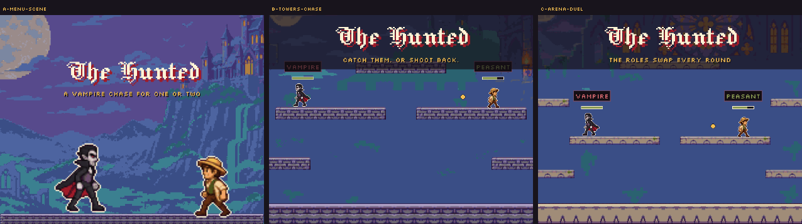

# README and store page refresh
<!-- index | refs: #22 | area: Docs, Art -->

**Date:** 2026-11-20 · **Area:** Docs, Art · **Issue:** [#22](https://github.com/vectorviolet/the-hunted/issues/22)

## Context

The itch.io page is about to go public. The README still described the one-screen menu (1 PLAYER /
2 PLAYER) and its screenshots showed it, and `docs/store/` held only two covers and no page text.
The menu pages (#18) and the art pass (#19) are in, so the media could be retaken. README and store
media stay at full size (1920x1080 screenshots and GIF, 630x500 cover, 1280x640 GitHub social
preview); only devlog images are capped at 1280 px.

## What changed

- `docs/store/README.md` (the edit-page checklist and field values) and `docs/store/description.html`,
  following Chokepoint's and Highrise's store folders.
- Screenshots: main menu, mode menu, credits, level select and a round on each of Classic, Towers
  and Arena. `scripts/art_gen/shoot.py` takes the frames, `scripts/art_gen/make_media.py` writes the
  files, so all of it can be retaken.
- Three cover candidates in `docs/store/candidates/`, the default copied to `docs/store/cover.png`.
- A GitHub social preview, `docs/design/social-preview.png`, from the menu scene.
- README: the menu flow, VS AI / PVP wording, the play-in-browser link, the installer and the new
  screenshot table.

## Options: the itch.io cover

- **A, menu scene:** the title card, both characters on the menu backdrop. Readable at thumbnail
  size, shows who the game is about. Default pick.
- **B, Towers chase:** a real round with the HUD tags and a bullet in the air. Shows the game, but
  the figures are small at 630x500.
- **C, Arena duel:** the same idea on the Arena level.

## Decision

Pending the owner: the cover, the tagline, the description wording and the tags are proposals (the
PR lists three taglines). Claude's default is A, because the characters are large enough to read in
itch.io's small cover slot.

## Rejected alternatives

- **Keeping the 2752x1536 cover.** itch.io only uses 630x500, and nothing referenced the large file.
- **Cropping the staged level screenshots for B and C.** The characters landed at the edges of the
  crop; the covers now stage their own frame with the two characters close together.
- **A banner.** Optional on itch.io; not made.

## Result

The page text, the checklist and the media are in the repo. The owner picks the cover and the
tagline, edits the page and makes it public.
