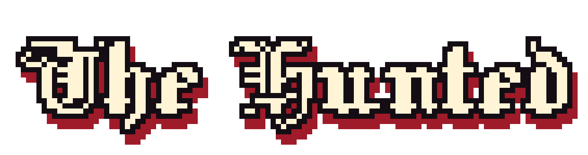

# A pixel-art logo for the README
<!-- index | refs: owner request, PR #27 | area: Docs, Art -->

**Date:** 2026-11-21 · **Area:** Docs, Art · **Issue:** none (owner request)

## Context

The repository was renamed to `vectorviolet/the-hunted` and went public together with the itch.io
page. The README opened with a plain `# The Hunted` heading and a lone coverage badge, while
Chokepoint's README opens with a wordmark image and a centered badge row. The game's own title is
drawn in Jacquard 12 in the menu, so the README should show the same lettering.

## Options

- **A, a scripted wordmark (chosen):** render "The Hunted" with the title font itself, in the
  palette, and scale it up by a whole factor.
- **B, Codex-generated logo candidates:** AI-generated lettering. Not chosen: it would be a new
  AI-made asset to credit and keep consistent, where the game already has the font and palette.

## Decision

The owner chose option A. `scripts/make_logo.py` draws the text with `settings.TITLE_FONT` at 24 px
(the smallest size where Jacquard 12 is legible, and a whole multiple of its grid), without
anti-aliasing, then adds a one-pixel INK outline and a CRIMSON drop shadow (the menu title's
colors, RIM fill) on that pixel grid. The result is scaled 15x with nearest-neighbor, so every logo
pixel is a crisp 15x15 block, on a transparent background (1695x450, about 5 KB). It is the same
font and colors as the menu, can be redrawn with one command, and adds no new asset license: the
font is SIL OFL and already credited.

The logo lives in `docs/logo.png`, not under `assets/`, so it is not shipped in every build. The
devlog shows a 10x copy (`docs/devlog/img/readme-logo.png`) to stay under 1280 px.

The README header is the logo as a full-width `<h1>` image, then a centered badge row: CI,
release, license, coverage and Python 3.12+ | pygame-ce, in Chokepoint's style.

## Result

Not done, left as a follow-up: using the logo on `docs/design/social-preview.png` and on the web
loader page.
